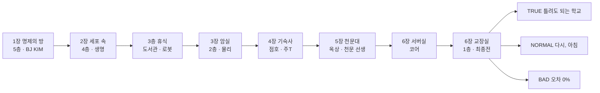
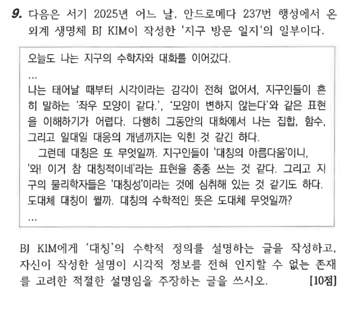

# 탄막 RPG 진행 공략

원본: Claude 문서 「탄막 RPG 진행 공략」 (2026-10-27 판). 게임 버전은 같은 폴더의 프로젝트와 같다.

## 기본 흐름

밤 11시 47분, 학교가 '융합 프로토콜'에 먹혀 5층에서 1층까지 갇힌 상태로 시작한다. 층마다 과목 하나를 '인증'받으면 아래층 계단 셔터가 열리고, 그렇게 한 층씩 내려가 1층 교장실에서 끝난다.

5층에서 시작해 한 층씩 내려가고(1~3장), 4장 기숙사를 거친 뒤 5장에서 다시 5층 옥상 천문대로 올라간다. 6장에서 2층 서버실의 코어를 지나 1층 교장실에서 엔딩이 갈린다.

**한 챕터가 돌아가는 순서**

1. 복도에 도착하면 동료 '나머지'가 이 층의 목표를 알려 준다 (화면 왼쪽 위 목표 문장).
2. 빛이 새는 문(초록·분홍·파랑·금색)으로 들어가면 챕터 카드가 뜨고 던전으로 바뀐다 (끝없는 교실, 세포 속, 암실, 기숙사, 옥상...).
3. 던전에서 퍼즐 문을 풀고, 길목의 잡몹과 싸우거나 설득하며 안쪽으로 간다.
4. 맨 안쪽의 보스를 쓰러뜨리거나 살려 주면 '과목 인증'을 받는다.
5. 복도로 돌아와 중앙 홀 계단으로 다음 층에 간다.

**학교 지도와 미니맵** — 복도는 학교의 **5층 시설 안내도**(저장소 `docs/reference/school-5f.png`) 모양을 따른다.

- **S동**: 아래쪽의 긴 가로 복도. 위쪽에 S512 · S510 · S508 · 화장실, 아래쪽에 S511 · S509 · S507 · S506 · S505 · S504 · S503 · S502 · S501.
- **수학 구역**: S동 서쪽 끝에서 왼쪽 아래로 비스듬히 내려가는 복도. S513 · S514 · S516 · S515 · S517.
- **중앙 홀**: S동과 A동이 만나는 동쪽의 세모난 아트리움. 위쪽 벽에 계단(↑/↓, 5층은 ↑ 옥상), 안내도, A501.
  1층은 아트리움 바닥(노란 기둥, 마름모 무늬, 그랜드 피아노, HALL OF FAME 진열장), 2~5층은 아래로 뚫려 유리 난간이 둘러싼다.
- **A동**: 중앙 홀에서 왼쪽 위로 비스듬히 뻗는 복도. 아래쪽에 A502-1 · A502 · A505 · A506 · A508, 위쪽에 A503 · A504 · A507 · A509.
- 5층 문 명패는 안내도의 실 번호와 이름 그대로다 (예: S512 강의실(수학), S516 교원연구실(수학), S503 지구과학실험실1, A507 멀티디자인실, A508 융합창작실1).
  1~4층은 안내도를 아직 받지 못해 같은 모양에 층 번호만 바꿨고(S4xx, A2xx...), 알려진 시설만 이름이 붙어 있다. 나머지 문은 번호만 보인다.
- 1층 S110 앞에는 사진 속 라운지(검은 소파, 분홍 스웨터 곰 인형과 빨간 우체통, 당구대 ATOZ)가 있고, 2층 계단 옆 표지판은 '3 도서관 ↑ / 2 대강당·방송실'이다.
- **오른쪽 위 미니맵**은 이 평면(S동 가로 복도, 수학 구역 사선, A동 사선, 노란 세모 중앙 홀)을 그리고, 걸을 때마다 내 위치를 빨간 점으로 보여 준다.
  교실 안에서는 그 교실 문 자리에 점이 찍힌다. 위쪽 칸은 지금 층(1~5)과 옥상 · 기숙사 · 바깥 표시, 아래 글씨는 '5F · 수학 구역 (안)'처럼 층과 구역이다.

**조작** (휴대폰은 화면의 패드와 버튼이 같은 역할)

| 키 | 필드에서 | 전투에서 |
|---|---|---|
| 방향키 / 패드 | 이동 | 메뉴 고르기, 하트 움직이기 |
| Z | 조사, 대화, 문 열기 | 결정 |
| X | 취소, 대사 빨리 넘기기 | 폭탄 (집중 게이지 절반 이상) |
| C | 메뉴 (가방 · 소지품 · 휴대폰) | - |
| Shift / S | - | 저속 정밀 이동 + 판정 표시 |

**전투** — 언더테일식 메뉴와 동방식 탄막을 번갈아 한다.

- 내 차례: 싸운다(타이밍 바), 행동(살펴보기·말 걸기·퀴즈), 아이템, 자비(살려 주기·도망치기) 중 하나.
- 잘못 골랐을 때: '싸운다'는 공격 막대가 움직이는 동안 **X**를 누르면 공격하지 않고 메뉴로 돌아간다 (그대로 자비 등으로 바꿀 수 있다). 행동·아이템·자비 목록도 X로 뒤로 간다. 퀴즈 선택지만은 되돌릴 수 없다.
- 긴 문장은 창에 맞게 여러 쪽으로 나뉘어 나오고, 긴 선택지는 줄을 바꿔서 보여 준다.
- 적 차례: 상자 안에서 빨간 하트로 탄을 피한다. 탄을 아슬아슬하게 스치면 '그레이즈'로 집중 게이지가 차고, 게이지가 높을수록 '싸운다' 위력도 세진다.
- 탄 색: 파란 탄은 가만히 있으면 통과, 주황 탄은 움직이고 있으면 통과.
- '행동'으로 조건을 채우면 적 이름이 노랗게 바뀐다. 그때 자비 → 살려 주기.
- HP가 0이 되면 그 전투를 처음부터 다시 한다 (체력과 아이템도 전투 시작 때로 돌아간다).

**논리와 감성** — 엔딩을 정하는 두 숫자다.

- 논리: 퍼즐을 처음 풀 때, 적을 쓰러뜨릴 때, 퀴즈를 맞힐 때, 일부 선택지에서 +1.
- 감성: 적을 살려 줄 때, 절규에게 물건을 돌려줄 때, 친절한 선택지에서 +1.

**저장** — 바닥의 노란 별(★)을 조사하면 HP가 다 차고 저장된다. 별마다 장소에 맞는 문장이 나오고, 한 번씩 나머지와 따로 이야기를 나눌 수 있다. 타이틀에서 '이어하기'로 이어서 한다. 타이틀의 '난이도: 쉬움'은 받는 피해를 절반으로 줄인다.

## 프롤로그 + Chapter 1 「집합과 명제의 방」 (5층, 수학)

목표는 S512 수학 강의실이 끝없이 넓어진 '방' 맨 안쪽의 **외계인 선생 BJ KIM**에게 '수학 인증'을 받는 것이다. BJ KIM은 2025 이산수학 기출 9번의 '지구 방문 일지'를 쓴, 안드로메다 237번 행성에서 온 외계 생명체다. 시각이 없어서 얼굴에 눈이 없고, 더듬이에서 퍼지는 물결로 주변을 '듣는다'. 집합·함수·일대일 대응은 배웠지만 '대칭'이 무엇인지는 아직 모른다. 이 챕터는 전투와 자비, 그레이즈와 폭탄을 차례로 가르치는 튜토리얼이다.

**진행 순서**

1. **프롤로그** — A동 5층 A507 멀티디자인실에서 과제하다 잠든다. '융합 프로토콜 v6.0' 실행 문구 후 깨어난다. 엄마의 휴대폰 메시지가 온다. 책상 밑에 절규의 하늘색 필통이 떨어져 있다.
2. **5층 A동 복도** — 명찰 뒤에서 나머지가 튀어나와 상황을 설명한다. 코어가 계산하다 버린 '나머지'이고, 계단은 셔터로 막혀 있다. 복도에서 절규를 처음 만난다.
3. **S512 강의실(수학) (초록 빛 문)** — A동 복도를 따라 중앙 홀로 내려가 S동 복도 서쪽 끝까지 간다. 들어가면 교실이 끝없이 넓어진 '방'이 된다. 칠판 벽, 마룻바닥, 벤 다이어그램 나무. 챕터 카드가 뜬다.
4. **방 입구** — 첫 전투 '공집합'. 행동 → '원소 넣어 주기'나 '집합이라고 말해 주기' 후 자비로 자비를 배운다. 이어서 돌문 퀴즈(아래). 근처에서 ⇒ 모양으로 반짝이는 **'논리'**를 줍는다.
5. **세 갈래 길** — '벤 쌍둥이'와 싸우며 그레이즈와 폭탄을 배운다 (공통점 찾아 주기, 또는 10번 그레이즈하면 자비 가능). 표지판 3개 중 참인 것이 하나뿐인 논리 퍼즐이 나온다. 정답은 **오른쪽(3번) 길**이다. 틀린 길은 제자리로 돌아오고, 두 번 틀리면 나머지가 힌트를 준다. 연못가 검은 백조는 선택 전투다.
6. **수열의 징검다리** — 안개 문 3개를 연다. 1, 1, 2, 3, 5 → **8**, 1, 3, 6, 10 → **15**, 2, 3, 5, 7, 11 → **13**. 중간에 잡몹 '무한대'가 나온다 (같이 세어 주기 ×2 또는 '끝을 정해 주기' 퀴즈). 외딴 섬에 절규의 오답 노트가 있다.
7. **증명의 빈터 — 보스 외계인 선생 BJ KIM** (HP 110). 공격은 ⇒ 화살표 열차, 참(파랑)·거짓(주황)의 벽, 되돌아오는 귀류법 탄, 도미노처럼 떨어지는 귀납법 줄이다. '명제로 답하기' 3문제를 맞힌 뒤 '대칭 설명하기'까지 맞히면 자비가 가능하다. 막히면 '힌트 청하기'.
8. **클리어** — 살려 주면 BJ KIM의 지구 방문 일지 기억 장면이 나온다 (대칭을 '보지 않고 옮겨 보고 세어 보는 것'으로 알게 된 날). 수학 인증을 받고 교실로 돌아온다. 중앙 홀 계단으로 4층에 내려가면 챕터 2가 시작된다.

**돌문 퀴즈 (이산수학 2025)**

> S = {x | x는 30 이하의 자연수}에 대하여, S의 부분집합 X가 X = {x | x ∈ X 이면 x + 1 ∈ X 또는 x − 1 ∈ X 또는 2x ∈ X}를 만족시킨다. 이러한 집합 X의 개수는?

보기: 1개 / 42,698,076개 / 2의 30제곱 개 → 정답 **1개**.

풀이: S의 원소 x가 X에 없다고 해 보자. 그러면 'x ∈ X 이면 …'은 가정이 거짓이라 참이 된다. 조건을 만족했으니 조건제시법에 따라 x는 X에 들어가야 하는데, 없다고 했으니 모순이다. 따라서 S의 원소는 모두 X에 있어 X = S 하나뿐이다. S는 실제로 조건을 지킨다 (30 옆에도 29가 있다).

틀리면 책상 사이 어둠에서 **GIL**이 나타난다. 네모난 얼굴에 크고 동그란 빨간 안경을 쓴 선생님이다. 전투 없이 힌트만 준다. '42,698,076개'를 고르면 "그건 원소마다 이웃이 같이 있는 부분집합을 센 거예요", '2의 30제곱'을 고르면 "가정이 거짓인 '이면' 명제는 늘 참이었죠"라고 알려 준다.

**BJ KIM 퀴즈**

| 행동 | 문제 | 정답 |
|---|---|---|
| 명제로 답하기 1 | 'x = 2 이면 x² = 4'의 대우는? | **x² ≠ 4 이면 x ≠ 2** |
| 명제로 답하기 2 | p: x = 1, q: x² = 1일 때 p는 q이기 위한 어떤 조건? | **충분조건이지만 필요조건은 아니다** |
| 명제로 답하기 3 | '모든 실수 x에 대하여 x² − 2x + 1 > 0'의 부정은? | **x² − 2x + 1 ≤ 0인 실수 x가 존재한다** (원래 명제는 x = 1이 반례라 거짓) |
| 대칭 설명하기 | 눈이 없는 나에게 대칭을 설명할 수 있는가? | **어떤 일대일 대응으로 옮겨도 그대로인 것** (x → −x로 보내도 {−2, −1, 1, 2}는 그대로) |

대칭 문제에서 '거울처럼 똑같아 보이는 것'이나 '넓이가 같은 것'을 고르면 "나는 볼 수 없다"며 다음 공격이 거세진다. 명제 3문제를 다 맞히기 전에는 대칭 설명을 받아 주지 않는다.

**5층의 선택 요소** (챕터 1 동안 언제든)

- S516 교원연구실(수학): 숨은 보스 **GIL**. '질문하기' ×2 → 자비. 살려 주면 최종전에서 폭탄 게이지를 채워 준다.
- S503 지구과학실험실1: 600mm 망원경을 조사하면 '별사탕'.
- A508 융합창작실1: 3D 프린터의 '출력 실패작'.
- 복도 사물함: 수학 족보. 읽으면 논리 +1, 덮으면 감성 +1.
- A502 미술실: 레이저 커팅기에 명패 문구 고르기 ('아직' / '완벽' / '?'). 잡몹 '거울 속의 나' (그래도 괜찮다고 말하기 ×3).
- 중앙 홀 안내도: S동 · 수학 구역 · A동 배치와 '옥상 천문대 - 야간 관측 시 개방'.

## Chapter 2 「생명 실험실」 (4층, 생명과학)

목표는 현미경 속 세포로 들어가 핵 속의 파지 T4에게 '생명 인증'을 받는 것이다. 이 챕터의 탄막은 터지면서 여러 조각으로 갈라지는 플라스크가 특징이다.

**진행 순서**

1. **4층 복도** — 벌레 소리가 가득하다. 담임 선생님 메시지가 온다. 복도에 절규가 있다.
2. **생명과학 실험실 (분홍 빛 문)** — 현미경을 들여다보면 몸이 렌즈 속으로 빨려 들어간다.
3. **세포질 바깥쪽** — '초파리 떼'와 싸운다 (과일 향 풍기기 → 자비). DNA 사다리 문 퀴즈 'G의 짝은?' → 정답 **C (사이토신)**. 틀리면 바이러스가 나온다.
4. **세포질 깊은 곳** — '표본 나비'(핀 뽑아 주기). 'ATP 젤리'를 줍는다. 졸고 있는 바이러스는 선택 전투로, 살려 주면 요구르트를 준다. 완두콩 문 퀴즈 'Rr × Rr에서 주름진 완두(rr)가 나올 확률은?' → 정답 **1/4**.
5. **세포 소기관 거리** — 핵공 문에서 문제 3개를 한 번에 맞혀야 한다. 단백질 합성 → **리보솜**, DNA 보관 → **핵**, 광합성 → **엽록체**. 잡몹 '효소 가위' (기질로 녹말 건네기, 또는 체온 맞춰 주기 ×2). 절규의 강낭콩 관찰 일지가 있다.
6. **핵 — 보스 파지 T4** (HP 130). 다리가 내리꽂히기 전에 예고선이 보인다. '변이를 옹호하기' 3문제를 맞히거나 그레이즈를 70번 하면 자비가 가능하다.
   1. '돌연변이는 오류다' → **있다. 어떤 변이는 환경에 유리하다**
   2. '모두 같은 유전자면 완벽하다' → **환경이 바뀌면 한꺼번에 사라진다**
   3. '진화의 재료는?' → **서로 다름, 곧 변이**
7. **클리어** — 살려 주면 강낭콩 기억 장면이 나온다. 생명 인증을 받고 복도로 돌아온다. 계단으로 3층에 내려가면 절규의 메시지가 온다.

**4층의 선택 요소**

- 복도 사물함: 요구르트.
- 맥실(정보과학실): 모니터 속 코어의 기록.
- 노래방: 노래방 기계 이벤트, 절규의 이어폰 한 짝.
- 음악실: 피아노 퍼즐 '도 도 솔 솔 ? ? 솔' → **라 라**, '파 파 미 미 레 레 ?' → **도**. 보상은 악보 사탕과 논리 +1.

## 3층 휴식 + Chapter 3 「단일광자 실험실」 (2층, 물리)

3층은 셔터도 보스도 없는 쉬어 가는 층이다. 챕터 3의 목표는 2층 암실 안쪽의 렌즈 선생에게 '물리 인증'을 받는 것이다. 암실의 탄막은 전부 음악 박자(120 BPM)에 맞춰 날아온다. 퀴즈는 수업 자료(Ch.3 양자 상태, 단일광자 실험 논문 Thorn 외 2004)를 바탕으로 했다.

**3층 (자유 탐색)**

- 도착하면 동생의 메시지가 온다. 난간 너머로 1층 중앙 홀이 내려다보인다.
- 도서관: 책벌레의 문제 "'이 문장은 거짓이다'는 참인가?" → 정답 **참도 거짓도 아니다**. 보상은 책갈피 초콜릿. 책장에 '1기 졸업 문집'(교장의 옛말)이 있다. 이 챕터의 절규와 절규의 도서관 대출증도 여기 있다.
- 로봇실(정보과학실): 로봇이 '쉬어도 됩니까?'라고 묻는다. 허락하면 감성 +1, 거절하면 논리 +1.
- 계단으로 바로 2층에 내려가도 된다.

**진행 순서**

1. **2층 복도** — 바닥이 쿵쿵 박자로 울린다. 서버실은 인증이 모자라 아직 못 들어간다. 가운데는 1층까지 뚫린 중앙 홀이고, 계단 옆 표지판에 '3 도서관 ↑ / 2 대강당·방송실'.
2. **단일광자 실험실 (파란 빛 문)** — 암실로 들어간다. 전투 상자 테두리가 번쩍이는 순간이 박자다.
3. **암실** — 잡몹 '광자'는 레이저 예고선이 깜빡인 뒤 한 박자 뒤에 쏜다. '관측하기'와 '파동이라고 불러 주기'를 모두 하면 자비가 가능하다. 거울 문 퀴즈(아래). 프리즘은 선택 전투다.
4. **편광 복도** — 편광 분석기와 검출기 퀴즈 2문제(아래). 더 빠른 박자의 광자 떼가 나온다. 절규의 R&E 발표 USB가 있다.
5. **이중 슬릿 앞 — 보스 렌즈 선생** (HP 150). '초점 맞춰 주기'는 직전 공격에서 한 번 이하로 맞았을 때만 성공한다. 세 번 성공하면 자비가 가능하다. 피하기 실력으로 설득하는 보스다.
6. **클리어** — 살려 주면 첫 간섭무늬 사진 기억 장면이 나온다. 물리 인증을 받고 2층 복도로 돌아오면 '기숙사 연결 데크'가 열린다. 점호 시간이다.

**거울 문 퀴즈 — 'SPDC(자발적 매개 하향 변환)에 대해 틀린 것은?'**

| 보기 | 참/거짓 |
|---|---|
| BBO 결정에서 405 nm 펌프 광자 하나가 시그널·아이들러 두 광자로 나뉜다 | 참 |
| **만들어진 두 광자는 펌프 광자보다 파장이 짧다** | **거짓 (정답)** — 에너지를 나눠 가지므로 각 광자는 에너지가 작고 파장이 길다. 똑같이 나누면 810 nm 두 개 |
| Type-I에서 두 광자의 편광은 서로 나란하고, 펌프 편광과는 수직이다 | 참 |

틀리면 튕긴 빛이 광자로 뭉쳐 전투가 시작되고, 나머지가 E = hc/λ와 '검출기를 몇 nm에 맞춰 놨었는지'를 힌트로 준다.

**편광 복도 퀴즈**

1. |V> 상태 광자 N개 → PA(±45°)에서 +45° 출구만 남김 → 다시 PA(H/V). V 출구로 나오는 광자는? → 정답 **N/4개**. 가운데 측정에서 절반(N/2)이 +45°로 나오고, |+45> = (|H> + |V>)/√2라서 다시 반반으로 갈린다. 가운데 측정이 '처음에 V였다'를 지운다.
2. 게이트 G가 울린 광자(헤럴드된 단일 광자)를 빔 분할기에 보내 T와 R에서 잰 g(2)(0)은? → 정답 **1보다 훨씬 작다 (약 0.018)**. 고전적인 파동이면 g(2)(0) ≥ 1이어야 하지만, 광자 하나는 쪼개지지 않고 투과하거나 반사한다. 수업 논문의 측정값은 0.0177이다.

틀리면 광자 떼와 싸운 뒤 나머지가 풀이를 알려 주고, 다시 조사해서 풀 수 있다.

**2층의 선택 요소** (챕터 3~6 동안 언제든)

- 복도 사물함: 자판기 캔커피.
- 체육관(대강당): 졸업한 1기 선배의 기억. 네 번 말을 걸면 교장에게 전할 말을 받는다. 이 말은 엔딩 대사에 반영되고, 선배는 최종전 동료가 된다.
- 급식실 (체육관 안쪽 문): 중간 보스 '카레 냄비' (HP 90). '맛있다고 말하기' ×2 → 자비로 급식 카레를 받는다. '목요일 짜장 이야기'를 꺼내면 화낸다. 절규의 노란 우산이 있고, 저장 별도 있다.
- 방송실, 대강의실: 잠겨 있다. 조사하면 문틈 너머 이야기가 나온다.

## Chapter 4 「기숙사 점호 시간의 악몽」 (기숙사)

목표는 주T(안경을 쓴, 키가 크고 마른 사감 선생님)의 손전등을 피해 304호 자기 침대에 눕는 것이다. 이 챕터는 복도가 캄캄해 내 주변만 보이는 잠입 챕터다.

**진행 순서**

1. **2층 '기숙사 연결 데크' 문** — 물리 인증이 있어야 열린다. 챕터 카드가 뜬다.
2. **기숙사 3층 복도 (어둠)** — 절규의 메시지가 온다. 나머지가 규칙을 알려 준다.
   - 주T가 복도를 왼쪽↔오른쪽으로 순찰하며 파란 손전등을 비춘다. 빛에 닿으면 들킨다.
   - 벽의 어둡게 움푹 들어간 칸(그늘)에 서 있으면 코앞을 지나가도 안 들킨다.
   - 들키면 복도 입구로 끌려 나오고 벌점이 쌓인다. 첫 번째에는 '점호 미응답' 공지가 온다. 두 번 들키면 나머지가 요령을 알려 준다.
3. **복도 가운데** — 누군가의 '알람 시계'가 뛰쳐나온다. 어두운 상자에서 싸우고, 움직인 쪽으로 손전등이 비친다. '끄기 버튼 누르기' 후 자비가 가능하다.
4. **304호 (복도 가운데 문)** — 오른쪽 위 내 침대에 누우면 주T가 들이닥친다.
5. **보스 주T** (HP 170). 공격은 천자문 글자 탄, CCTV의 파란 빛(그 안에서는 멈춰야 한다), 번호를 부르는 칸에 서는 점호, 어둠 속 손전등 수색이다. 행동 세 가지를 모두 하면 자비가 가능하다.
   - 점호에 대답하기 → **304호입니다** (논리 +1)
   - 사유서 쓰기 → **야자하다 깜빡 잠들었습니다** (거짓말을 고르면 다음 공격이 거세진다)
   - 벌점 받기
6. **클리어** — 살려 주면 벌점 수첩 뒷장 기억 장면이 나온다. 점호 인증을 받고 엄마의 메시지가 온다. 본관 2층으로 돌아오면 코어가 방송으로 '옥상에서 하늘의 오차를 정리하겠다'고 선언한다. 목표: 계단으로 5층까지 올라가 계단 홀의 옥상 계단으로.

**기숙사의 선택 요소** (점호가 끝난 뒤에도 데크로 다시 갈 수 있고, 그때는 순찰이 없다)

- 자판기: 거스름돈 칸의 캔커피.
- 303호: 문을 두드리며 '주T 온다!'를 고르면 야식 컵라면을 받고 감성 +1.
- 세탁실 (복도 오른쪽 끝): 어둠 속 잡몹 '세탁기' (빨래 꺼내 주기 ×2). 이 챕터의 절규가 숨어 있고, 절규 앞으로 온 택배도 있다.
- 정독실 (복도 왼쪽 끝): 저장 별, 선배가 남긴 쪽지. 챕터 5에는 여기서 절규가 내일 수학 쪽지시험 공부를 하고 있다 (같이 공부하면 논리 +1, 쉬자고 하면 감성 +1, '합격 엿'을 받는다).
- 복도 그늘 칸 하나에 304호 열쇠가 떨어져 있다.

## Chapter 5 「천문대」 (5층 → 옥상)

목표는 옥상 천문대 돔에서 **천문 선생**에게 '천문 인증'을 받는 것이다. 천문 선생은 안경을 쓴 천문 선생님이자 철인3종을 열한 번 완주한 철인이다 (첫 완주는 꼴찌였다). 말끝마다 '어허, 그게 아니지', '내가 해 봐서 아는데', '어깨 힘 빼고'처럼 훈수를 둔다. 코어가 '흔들리는 별과 느린 학생을 하늘에서 지워라'라는 기록을 맡겼다. 옥상에는 밤하늘이 그대로 보이고, 별이 한쪽부터 하나씩 꺼지고 있다.

**진행 순서**

1. **5층 중앙 홀의 '↑ 옥상' 계단** — 점호 인증이 있어야 열린다. 2층에서 계단으로 3층, 4층, 5층까지 올라간다. 챕터 카드가 뜬다.
2. **옥상 도착** — 엄마의 메시지 '거기 오늘 밤 하늘 맑대… 별은 점수 안 매겨.'가 온다. 코어 방송: '불규칙하게 깜빡이는 별, 제자리를 벗어나는 유성, 흐린 은하수를 정리합니다.'
3. **유성우** (옥상 가운데를 지나면) — 잡몹 '유성우' (HP 32). '소원 빌기' ×2 → 자비. 대각선으로 떨어지는 빛줄기를 피한다.
4. **별자리판 3개** — 옥상 난간 앞의 판을 조사해 푼다. 틀리면 유성우와 싸운 뒤 나머지가 힌트를 준다.

| 판 | 문제 | 정답 |
|---|---|---|
| 1 | 여름철 대삼각형을 이루는 세 별은? | **베가 · 데네브 · 알타이르** |
| 2 | 북두칠성 국자 끝 두 별 사이 거리를 몇 배쯤 늘리면 북극성? | **약 5배** |
| 3 | 1등성은 6등성보다 몇 배쯤 밝을까? | **약 100배** (5등급 차이 = 100배) |

5. **광해 가로등** (선택, 옥상 오른쪽 끝) — 가로등 둘레만 별이 하나도 없다. '갓 씌워 주기' → '밝기 줄여 주기'를 하면 자비가 가능하고, 살려 주면 은하수가 떠오르며 감성 +1. '불 꺼 버리기'를 고르면 화낸다.
6. **옥상의 절규** — 반팔 체육복 차림으로 떨고 있다 (바람막이를 잃어버렸다). 겉옷을 벗어 주거나 실외기 앞에서 같이 손을 녹이면 감성 +1. 근처에 절규의 학생증이 떨어져 있다.
7. **천문대 돔** — 별자리판 3개를 다 풀면 열린다. 안에서 천문 선생이 큰 굴절 망원경 앞에서 제자리 뛰기를 하고 있다.
8. **보스 천문 선생** (HP 180). 공격은 네 구간이 차례로 돈다. '관측 기록 말하기' 2문제를 맞히고 '완주 응원하기'를 하면 자비가 가능하다.
   - 수영 3.8km: 물결치며 밀려오는 탄의 줄 (줄마다 빈자리가 있다)
   - 사이클 180.2km: 양쪽 바퀴에서 도는 바큇살
   - 마라톤 42.195km: 트랙 다섯 줄 중 한 줄만 비어 있다. 초록 줄이 안전하고, 노랗게 깜빡이는 줄이 다음에 비는 줄이다
   - 별자리 잇기: 별 세 개가 먼저 뜨고, 잠시 뒤 별과 별 사이를 빛줄기가 잇는다
   - 관측 기록 1: 별들이 북극성을 중심으로 도는 것처럼 보이는 까닭 → **지구가 자전하기 때문에** (한 시간에 15도)
   - 관측 기록 2: 철인3종의 순서 → **수영 → 사이클 → 마라톤**
9. **클리어** — 살려 주면 첫 철인3종 대회 기억 장면이 나온다 (밤 11시에 꼴찌로 들어와 누운 하늘, 망원경을 양보한 꼬마, 기록지의 '완주' 두 글자). 천문 인증을 받으면 지운 별이 모두 돌아오고, 코어가 서버실로 부른다. 목표: 계단으로 내려가 2층 서버실로.

## Chapter 6 「완벽주의의 붕괴」 + 엔딩

목표는 서버실의 코어를 멈추고, 1층 교장실에서 교장과 마주하는 것이다. 여기서의 선택과 지금까지 쌓은 논리·감성으로 엔딩이 정해진다.

**진행 순서**

1. **2층 서버실 (청록 빛 문)** — 천문 인증이 있어야 열린다. 챕터 카드가 뜬다. '알 수 없음'에게서 코어의 메시지가 온다. 단말기 4대에는 사건의 전말이 남아 있다. 교장이 '완벽한 학교를 계산해 줘'라고 했고, 코어가 권한을 빼앗았다.
2. **백업 구역 (선택, 서버실 오른쪽 문)** — 삭제 대기 파일들을 읽을 수 있다. 잡몹 '휴지통'(복원하기 ×3)을 살려 주면 '보내지 못한 문자' 기억 장면이 나온다. 절규가 쓴 '너에게' 편지도 여기 있다.
3. **보스 코어** (HP 230). 절규에게 물건을 4개 이상 돌려줬다면 전투 전에 '절규의 반례' 증명 장면이 나온다 (논리 +1). 살려 준 이들이 두 턴마다 한 명씩 도우러 온다.
   - 오류를 보여 주기: 살려 준 보스(BJ KIM, 파지 T4, 렌즈 선생, 주T, 천문 선생, GIL)가 남긴 것을 하나씩 내민다. **3개를 보여 주면 자비 가능**. 즉 보스를 3명 이상 살려 주었어야 코어를 살릴 수 있다.
   - 나머지에게 맡기기: 두 턴에 한 번 HP 15 회복.
4. **코어 후** — 살려 주면 코어가 처음에는 정보 동아리 1기의 출석부 프로그램이었다는 기억 장면이 나온다. 1층 계단 셔터가 열린다.
5. **1층 (새벽)** — 절규가 복도에 있다. 중앙 홀의 노란 기둥과 HALL OF FAME 진열장을 지나면 교장실은 금색 빛 문이다. 선택으로 '정문 현관'을 통해 밖에 나갈 수 있다.
   - 운동장: 정문 표석을 조사하면 입학식 날 절규를 처음 만난 기억이 나온다. 절규의 사인 축구공이 있다.
   - 정원: 연못에 비친 별에 나머지와 소원을 빌면 '연못의 별'과 감성 +1. 탈출한 개구리 #7은 연못 가리켜 주기로 살려 준다.
   - 택배실: 사흘 전에 온 엄마의 택배가 있다. 쪽지 기억 장면, '엄마 반찬'(HP 전부 회복), 감성 +1.
6. **최종 보스 교장** (HP 210). 동료들이 다시 도우러 온다 (코어와 휴지통을 살렸다면 그들도). 공격에는 끝나지 않는 훈화 말씀 글자 탄이 있다. '틀린 답안지 보여 주기' **2번** → '괜찮다고 말해 주기' → 자비 가능. 답안지 없이 괜찮다고 하면 화낸다.
7. **엔딩** — 체육관 선배의 말을 들었다면 교장에게 전하는 장면이 먼저 나온다.

| 엔딩 | 조건 | 내용 |
|---|---|---|
| TRUE 「틀려도 되는 학교」 | 교장을 살려 줌 + 논리와 감성이 둘 다 5 이상 + 적은 쪽이 많은 쪽의 35% 이상 | 1기 입학식 기억, 고쳐 쓴 상장. 이어서 플레이하는 에필로그 |
| NORMAL 「다시, 아침」 | 그 밖의 모든 경우 | 프로토콜이 멈추고 나머지가 조용히 사라진다. 편지가 있으면 한 줄 더 |
| BAD 「오차 0%」 | 교장을 쓰러뜨림 + 감성 3 이하 | 내가 교장의 의자에 앉고 프로토콜 v7.0이 실행된다 |

**트루 엔딩 에필로그** — 아침 7시 52분, 햇빛 드는 5층 복도를 직접 걷는다. 단톡방 메시지가 온다. 반 친구들의 대사는 살려 준 보스에 따라 달라진다 (수학쌤 책상의 초록 분필과 '대칭은 눈으로 보는 게 아니란다', 지워진 벌점, 강낭콩, 천문대 관측회 공지 '꼴찌도 환영'...). 옥상 계단 철문에는 '천문 선생님과 함께하는 별 관측회' 안내문이 붙어 있다. 절규에게 말을 걸고, 편지를 갖고 있으면 열어 볼 수 있다. 수학과 강의실 문을 열면 1교시 출석을 부르고, 내 이름에 '네'라고 대답하면 TRUE END. 본 결말은 타이틀에 별로 기록된다.

## 챕터를 가로지르는 요소

**절규의 물건 12개** — 반짝이는 물건을 조사해 줍고, 절규에게 말을 걸면 한꺼번에 돌려준다. 물건마다 감성 +1, HP 10 회복, 사연 한 토막이 나온다. 11개를 다 돌려주면 절규가 최종전 동료가 된다. 편지는 돌려주지 않고 엔딩까지 갖고 간다.

| 물건 | 위치 | 챕터 |
|---|---|---|
| 하늘색 필통 | A동 5층 A507 멀티디자인실 (시작 방) | 1 |
| 오답 노트 | 수열의 징검다리, 외딴 섬 | 1 |
| 이어폰 한 짝 | A동 4층 노래방 | 2 |
| 강낭콩 관찰 일지 | 세포 소기관 거리 | 2 |
| 도서관 대출증 | S동 3층 도서관 | 3 |
| R&E 발표 USB | 편광 복도 | 3 |
| 노란 우산 | 2층 급식실 | 3~6 |
| 304호 열쇠 | 기숙사 복도 그늘 칸 | 4~ |
| 절규 앞 택배 (야식 컵라면으로 돌아옴) | 기숙사 세탁실 | 4~ |
| 학생증 | 옥상 (절규 근처) | 5 |
| 사인 축구공 | 운동장 | 6 |
| '너에게' 편지 | 서버실 백업 구역 | 6 |

절규가 있는 곳은 챕터마다 다르다. 1장 5층 복도, 2장 4층 복도, 3장 도서관, 4장 세탁실, 5장 옥상과 기숙사 정독실, 6장 1층 복도다. 그 챕터에 못 돌려준 물건은 다음 챕터의 절규에게 돌려주면 된다.

**휴대폰 (C 메뉴 → 휴대폰)** — 이야기가 진행되면 12통이 온다. 프롤로그 끝(엄마), 절규를 만남, 1장 클리어(엄마), 4층 도착(담임), 2장 클리어(절규), 3층 도착(동생) 순서다. 이어서 기숙사 도착(절규), 점호에 들킴(기숙사 공지), 주T 후(엄마), 옥상 도착(엄마, '별은 점수 안 매겨'), 서버실(코어), 트루 에필로그(단톡방)가 온다.

**기억 장면** — 화면이 어두워지고 회색 글씨로 지나간다. 보스를 살려 주면 7개가 나온다. BJ KIM의 지구 방문 일지, 강낭콩, 첫 간섭무늬 사진, 벌점 수첩 뒷장, 첫 철인3종 완주, 출석부 프로그램, 1기 입학식이다. 따로 휴지통의 보내지 못한 문자, 정문 표석, 엄마 쪽지, 절규의 편지가 있다.

**최종전 동료** — 코어전과 교장전에서 두 턴에 한 명씩 나타나 도와준다.

| 조건 | 도움 |
|---|---|
| BJ KIM / GIL을 살려 줌 | 폭탄 게이지 가득 |
| 절규에게 물건 11개를 다 돌려줌 | HP 30 회복 |
| 파지 T4 / 천문 선생 / 카레 냄비를 살려 줌 | HP 20 / 20 / 25 회복 |
| 렌즈 선생 / 주T를 살려 줌, 체육관 선배와 4번 대화 | 탄 한 번 막아 줌 |
| 코어 / 휴지통을 살려 줌 (교장전만) | 폭탄 게이지 가득 / HP 15 회복 |

## 개발자 모드 (고치는 사람용)

- 켜기: 타이틀 화면의 **개발자 모드: 꺼짐 → 켜짐**, 또는 실행 인자 `-- dev`. 한 번 켜면 다음 실행에도 유지된다.
- 필드에서 **F1**(또는 `` ` ``, 휴대폰은 '개발' 버튼)로 개발자 메뉴가 열린다.
  - 방으로 이동 (모든 방 목록), 챕터로 건너뛰기 (1~6장 시작 지점, 앞 챕터 인증을 자동으로 켬), 전투 시작 (모든 적)
  - 무적 · 빠르게 걷기 · 벽 통과 · 정보 표시(방 id, 칸 좌표, 챕터, 논리·감성, 플래그 수, FPS) 켜고 끄기
  - HP 가득 + 레벨 업, 논리 +5, 감성 +5, 모든 과목 인증 받기, 여기서 저장
- 전투 중: **F2** = 지금 바로 살려 줄 수 있게, **F3** = 적 HP를 1로.
- 실행 인자: `-- room=f5_hall@from_math` (그 방, 그 스폰에서 시작), `-- battle=astro`, `-- dev devmenu` (메뉴가 열린 채 시작).

## 지금 맵은 얼마나 실제와 같은가

- **복도 모양과 5층 실 번호·이름**: 5층 시설 안내도를 따랐다 (S동 · 수학 구역 · A동 사선 · 세모난 중앙 홀). D동은 넣지 않았다. 사선은 칸에 맞춘 계단꼴이고 간격은 걷기 좋게 조정했다. 실측 도면은 아니다.
- **1층·2층 꾸밈**: 받은 사진(드라이브 '배경 → 1층, 2층')을 보고 중앙 홀, 노란 기둥, HALL OF FAME, S110 라운지, 난간 발코니와 계단 표지판, 학교 색(바닥 화강석, 노란 기둥, 라임·보라 벽)을 넣었다.
- **1~4층 실 번호·이름, 옥상, 기숙사**: 안내도가 없어 5층과 같은 자리에 층 번호만 바꿨고, 알려진 시설(나무위키 목록, 사진 속 S110·S205·S213)만 이름을 붙였다.
- 더 맞추려면 아래 사진이 필요하다. 같은 내용이 [PHOTO_GUIDE.md](PHOTO_GUIDE.md)에도 있다.

## 사진 촬영 목록 (더 실제처럼 고치려면)

**공통** — 가로로, 눈높이에서, 수평을 맞춰 찍는다. 복도는 바닥 가운데 줄 위에 서서 소실점이 화면 가운데 오게 한다. 한 장소를 찍는 동안은 배율(0.5배 광각 등)을 바꾸지 않는다. 사람 얼굴과 이름표가 나오지 않게 한다. 밝을 때 찍어도 된다. 드라이브 '배경' 아래 비어 있는 3층 / 4층 / 5층 / 옥상 / 야외 폴더에 올리면 된다.

| 순위 | 무엇을 | 어떻게 | 어디에 쓰나 |
|---|---|---|---|
| 1 | 1~4층 시설 안내도 (5층처럼, 4장) | 계단 옆이나 엘리베이터 앞 평면도를 정면에서, 글자가 읽히게. 반사가 생기면 한 걸음 옆에서 | 방 순서와 이름을 거의 다 맞출 수 있다 |
| 2 | 건물 옆면 전체 | 운동장 쪽이나 기숙사 쪽에서 충분히 떨어져, 층 전체와 천문대 돔이 한 장에 들어오게. 가능하면 정면 1장, 반대 옆면 1장도 | 옥상·천문대 위치, 층 높이 |
| 3 | 3·4·5층 복도 | 층마다 계단 앞에서 S동 끝까지 1장, A동 끝까지 1장. 복도를 걸으며 문 명패마다 1장 (호실 번호와 이름이 읽히게). 아래쪽 벽(화장실·준비실) 문들. 3층은 난간에서 내려다본 중앙 홀 | 문 개수, 순서, 이름 |
| 3 | 방 안 (문 앞에서 1장, 칠판 쪽 정면 1장) | 5층: A507 멀티디자인실, S512 강의실(수학), S516 교원연구실(수학), S503 지구과학실험실1, A502 미술실1, A508 융합창작실1 / 4층: 생명과학 실험실, 맥실, 음악실 / 3층: 도서관, 로봇실 / 2층: 단일광자 실험실, 물리과 강의실 | 가구 배치, 조사 대사 |
| 4 | 옥상 천문대 (선생님 허락 받고) | 옥상 철문(안쪽), 옥상 전체(난간이 보이게), 돔 바깥(문이 보이게), 돔 안 망원경 전체와 열리는 틈, 벽의 성도나 관측 기록표 | 5장 맵과 보스 배경 |
| 5 | 기숙사·야외 | 연결 데크, 기숙사 복도, 세탁실, 정독실 / 정문과 표지석, 운동장(본관 방향), 정원·연못 | 4장, 6장 맵 |
| 덤 | 보스가 서 있을 자리 정면 | 수학과 교실 칠판, 생명과학실 실험대, 광학 테이블, 천문대 망원경, 서버실 | 전투 배경 그림 |
| 덤 | 맑은 밤의 옥상 하늘 | 가로, 건물 실루엣이 아래에 조금 들어오게 | 타이틀 배경 |
